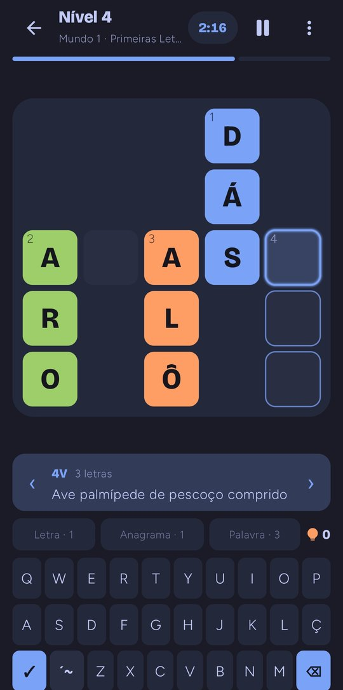
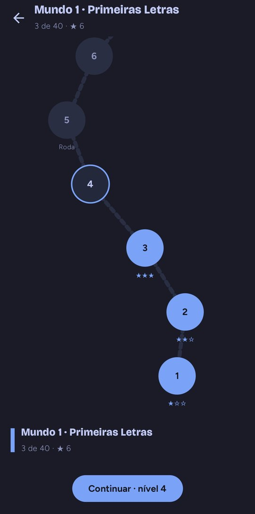
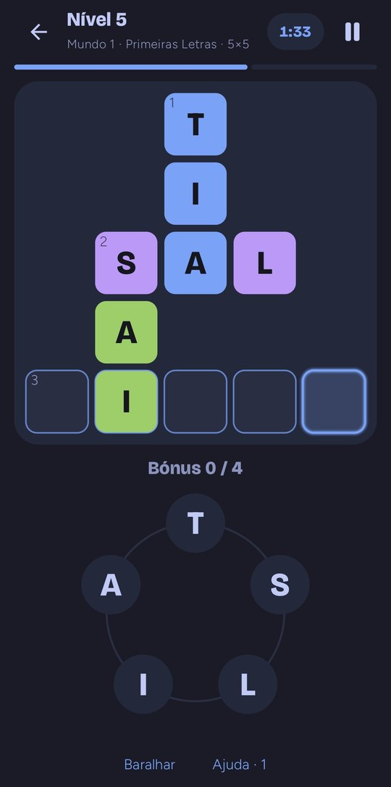
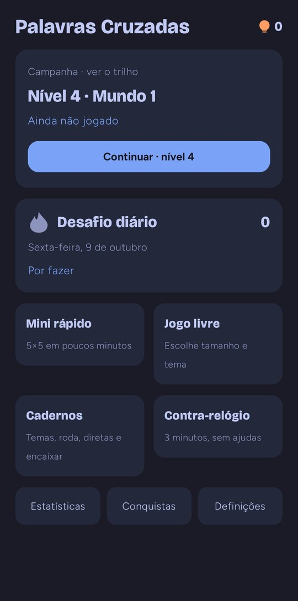
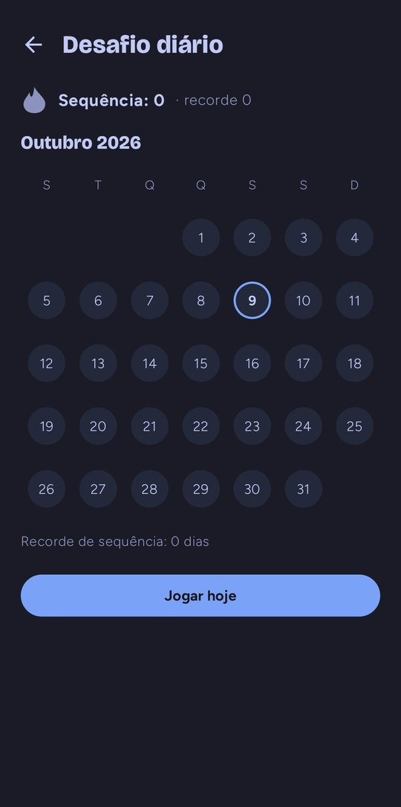
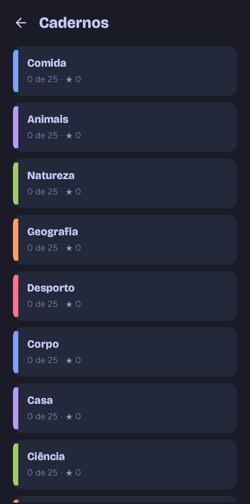
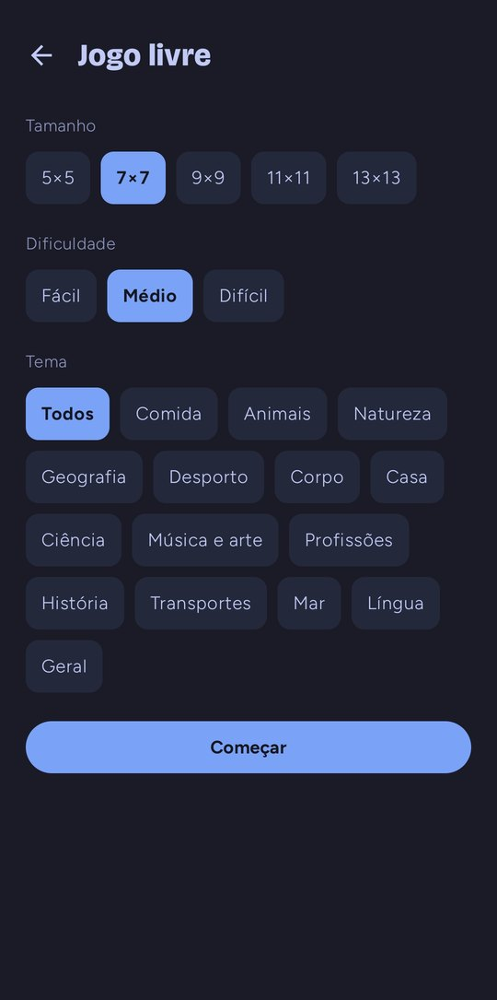
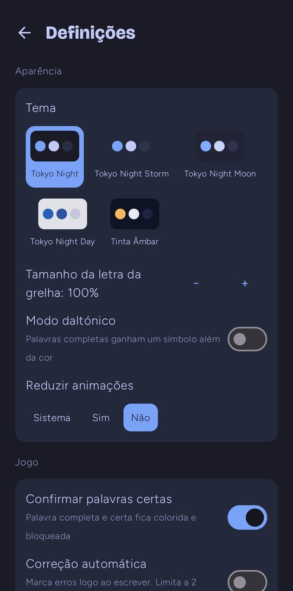
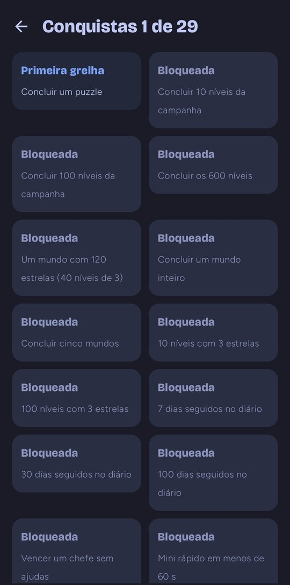
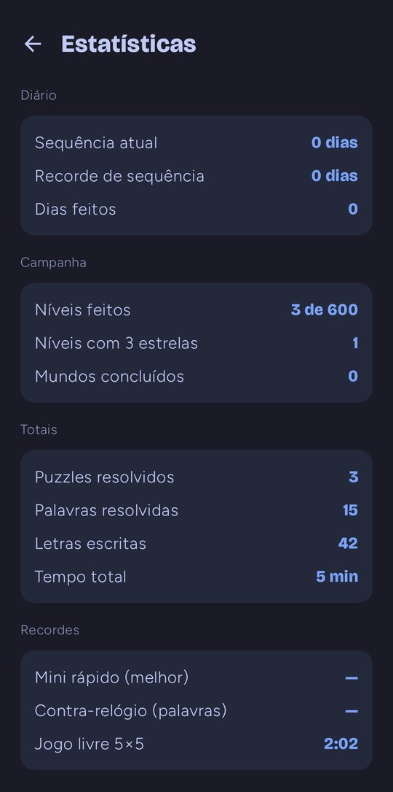

<div align="center">

# Palavras Cruzadas

**An offline crossword game for Android, in European Portuguese, built with Kotlin and Jetpack Compose.**
A 600-level campaign, a daily challenge, letter wheels, arrow-word grids and themed puzzle books. No ads, no accounts, no internet.

[](https://github.com/SyscallBrain/PalavrasCruzadas/actions/workflows/ci.yml)
[](LICENSE)


  

</div>

> The game's interface and all of its content (clues, answers, themes) are in **European Portuguese** (pt-PT, 1990 spelling agreement). The code, comments and documentation are in English.

## Features

- **Campaign**: 600 levels across 15 themed worlds, up to 3 stars per level, and a boss at the end of every world. Grids grow from 5×5 to 13×13.
- **Daily challenge**: the same puzzle for everyone on a given day, with a calendar, streaks and an optional reminder.
- **Free play** and a **quick 5×5 mini**, with size, difficulty and theme to choose from.
- **Hidden keyword** levels: some cells spell a secret word you can guess before the grid is done.
- **Letter wheel**: drag across the letters to form the grid's words, with bonus words.
- **Diretas** (arrow-words, with the clues inside the grid) and **fit-it** puzzles (place the given words in the grid).
- **Puzzle books**: 14 themes with 25 puzzles each, plus three books of wheel, diretas and fit-it puzzles.
- **Time attack**: as many words as you can in three minutes, no hints.
- **Hints** (reveal a letter, reveal a word, check the grid, show an anagram), earned with stars and daily challenges. Nothing to buy.
- **Full Portuguese accents** (Á À Â Ã É Ê Í Ó Ô Õ Ú Ç) with an in-app keyboard: long-press a vowel or use the `´~` key. An optional setting accepts unaccented letters.
- **Achievements**, statistics and records.
- **Five themes**: Tokyo Night (Night, Storm, Moon, Day) and Tinta Âmbar.
- **Accessibility**: colour-blind mode, adjustable grid letter size, TalkBack descriptions, physical keyboard support and a two-column layout for tablets and landscape.
- **Privacy**: works 100 % offline and does not request the internet permission. Progress can be exported to and imported from a JSON file.
- A home-screen widget with today's challenge.

## Screenshots

<table>
  <tr>
    <td align="center"><br><sub>Home</sub></td>
    <td align="center"><br><sub>Classic crossword</sub></td>
    <td align="center"><br><sub>Letter wheel</sub></td>
    <td align="center"><br><sub>Campaign trail</sub></td>
  </tr>
  <tr>
    <td align="center"><br><sub>Daily challenge</sub></td>
    <td align="center"><br><sub>Puzzle books</sub></td>
    <td align="center"><br><sub>Free play</sub></td>
    <td align="center"><br><sub>Settings</sub></td>
  </tr>
  <tr>
    <td align="center"><br><sub>Achievements</sub></td>
    <td align="center"><br><sub>Statistics</sub></td>
    <td></td>
    <td></td>
  </tr>
</table>

## Install

Download the latest APK from [Releases](https://github.com/SyscallBrain/PalavrasCruzadas/releases/latest) (when one is published) and open it on your phone; you need to allow installs from unknown sources. Requires Android 8.0 or later.

You can also build it yourself, as described below.

## Build

Requirements:

- JDK 17 or later (the one bundled with Android Studio works)
- Android SDK with platform 37 (`compileSdk`) and `ANDROID_HOME` set, or a `local.properties` with `sdk.dir`
- Python 3 (the clue bank is validated before the tests run)

```bash
git clone https://github.com/SyscallBrain/PalavrasCruzadas.git
cd PalavrasCruzadas

./gradlew testDebugUnitTest :core:test   # unit tests (validates the clue bank first)
./gradlew assembleDebug                  # APK in app/build/outputs/apk/debug/
./gradlew installDebug                   # installs on a connected device or emulator
```

You can also open the folder in Android Studio and run the `app` configuration.

### Levels

The campaign, daily puzzles and books are generated on a computer and committed as assets; the app does not generate them. Regenerating everything takes about 40 minutes:

```bash
./gradlew :levelgen:run --args="all"      # writes app/src/main/assets/levels/
./gradlew :levelgen:run --args="--check"  # fails if the committed files no longer match the code
```

### Clue bank

```bash
python3 tools/validate_clues.py               # format, accents, AO1990 spelling, duplicates, targets
python3 tools/check_spelling.py               # spelling with hunspell (apt install hunspell hunspell-pt-pt)
python3 tools/compile_bank.py                 # content/clues/pt-PT/*.jsonl -> app/src/main/assets/clues/pt-PT.json
python3 tools/clue_report.py                  # where words are missing (theme × length, letters)
python3 -m unittest discover -s tools/tests   # tests for the tools themselves
```

### Release builds

`./gradlew assembleRelease` builds a minified (R8) APK. Without a keystore it is signed with the debug key, which is fine for local testing. To sign your own build, set the Gradle properties `palavrascruzadas.keystoreFile`, `palavrascruzadas.keystorePassword` and `palavrascruzadas.keyAlias` in `~/.gradle/gradle.properties`, or the `SIGNING_KEYSTORE_FILE`, `SIGNING_PASSWORD` and `SIGNING_KEY_ALIAS` environment variables. Pushing a `v*` tag runs the release workflow, which needs the matching repository secrets.

## Architecture

```
core/                 Plain Kotlin, no Android: text normalisation, puzzle model, clue bank,
                      generators (freeform, keyword, diretas, wheel, fit-it), gameplay rules,
                      campaign, daily, books, achievements and settings. Tested on the JVM.
levelgen/             CLI that pre-generates the campaign, daily puzzles and books
app/
  data/               typed DataStore (progress, saved games, statistics, settings),
                      asset loading, backup export/import
  ui/                 theme, home, trail, game, daily, books, free play, settings, statistics
  reminder/           daily reminder (WorkManager)
  widget/             today's challenge widget (Glance)
  feedback/           sounds and vibration
content/clues/pt-PT/  the clue bank: one JSONL file per theme
tools/                bank validation, spelling, compilation, reports and sound generation
```

- **Deterministic generation.** Every generator uses the Mulberry32 PRNG with stable seeds, so the same seed always gives the same puzzle. The first 730 daily challenges ship pre-generated; later days are generated on the phone with the same code and seed, and a test checks that both sides agree.
- **One generator, two places.** The `core` module runs both on the phone (free play, mini, time attack) and in `levelgen` (campaign, daily, books), so there is no second implementation to keep in sync.
- **A validated clue bank.** About 5,000 answers, each with 2–4 clues of graded difficulty. The validator checks the format, the alphabet, AO1990 spelling, Brazilian Portuguese forms, clues that give away the answer and duplicates, and it runs before every test build.
- **Compose all the way.** Material 3 with custom-drawn grids (a single `Canvas` per grid), a custom keyboard and no XML layouts.
- **Small and private.** No network code, no analytics and no third-party services. The only runtime permissions are vibration and, if you turn the reminder on, notifications.

## Contributing

Contributions are welcome: bug fixes, new clues, fact-checking existing ones, accessibility improvements and new ideas.

1. Fork the repository and create a branch from `main`.
2. Run `./gradlew testDebugUnitTest :core:test` before opening a pull request.
3. For new or changed clues, edit `content/clues/pt-PT/<theme>.jsonl`, then run `python3 tools/validate_clues.py`, `python3 tools/check_spelling.py` and `python3 tools/compile_bank.py`. If the levels need to change, regenerate them with `levelgen all` and review the diff.
4. Open a pull request that explains what changes and why. For larger changes, open an issue first.

Code, comments and commit messages are in English; the user interface and the content are in European Portuguese.

## Credits

- Fonts: [Bricolage Grotesque](https://fonts.google.com/specimen/Bricolage+Grotesque) and [Figtree](https://fonts.google.com/specimen/Figtree), under the [SIL Open Font License 1.1](https://openfontlicense.org) (license texts in [`LICENSES/`](LICENSES)).
- Sounds are synthesised in code by `tools/make_sounds.py`; no recorded audio is used.
- Colour themes based on [Tokyo Night](https://github.com/folke/tokyonight.nvim).
- The sound generator, colour-blind mode and parts of the UI come from the sister project [Sopa de Letras](https://github.com/SyscallBrain/SopaDeLetras).

## License

The code and the clue bank are released under the [MIT License](LICENSE). The bundled fonts keep their own [OFL licenses](LICENSES).
